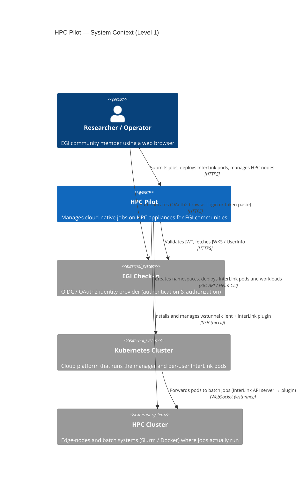

# Level 1 — System Context

**Question:** what does HPC Pilot do, and which people/systems does it interact with?

HPC Pilot sits between an EGI community user, the EGI Check-in identity
provider, a Kubernetes cluster (cloud), and an HPC cluster (batch systems). It
turns user-submitted container workloads into HPC batch jobs, routing them
through per-user InterLink pods that tunnel back to the HPC edge-node.

## Elements

| Element | Type | Role |
|---|---|---|
| Researcher / Operator | Person | Submits container jobs and manages their HPC environment through the web UI |
| HPC Pilot | System (this system) | The Flask manager + per-user InterLink pods + HPC edge agents |
| EGI Check-in | External system | Authenticates users and issues JWTs; authorizes via group entitlements |
| Kubernetes Cluster | External system | Runs the manager and the per-user InterLink pods (virtual-kubelets) |
| HPC Cluster | External system | Hosts the edge-node agents and the actual batch jobs |
