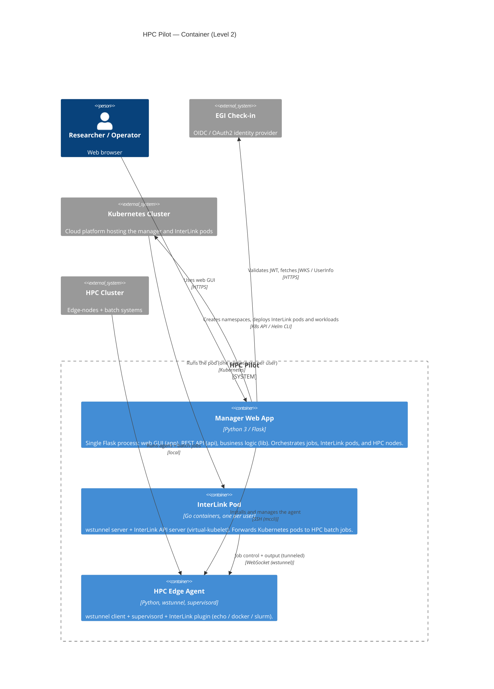

# Level 2 — Container

**Question:** what are the deployable/runtime units that make up HPC Pilot, and
how do they communicate?

The system decomposes into three runtime units: the **Manager web app** (a
single Flask process), a **per-user InterLink pod** in Kubernetes, and an
**HPC edge agent** on each HPC edge-node.

## Containers

| Container | Technology | Responsibility | Deployed by |
|---|---|---|---|
| Manager Web App | Python 3 / Flask | UI, REST API, orchestration, auth | `charts/manager/` (or local dev) |
| InterLink Pod | Go (interLink + wstunnel) | virtual-kubelet that forwards pods to HPC | Manager, per user (`charts/interlink/` values) |
| HPC Edge Agent | Python + wstunnel + supervisord | wstunnel client + InterLink plugin | Manager via `mccli` (SSH) |

## Key flows

- **Job submission** — user → manager → K8s `Deployment` pinned to the
  InterLink virtual-kubelet → InterLink forwards it over wstunnel to the HPC
  plugin, which runs the batch job.
- **Tunnel setup** — the HPC edge agent's wstunnel *client* connects back to the
  InterLink pod's wstunnel *server* using path-prefix routing on the shared
  `site.hostname` (`<hostname>/<namespace>`), so no wildcard DNS/TLS is needed.
