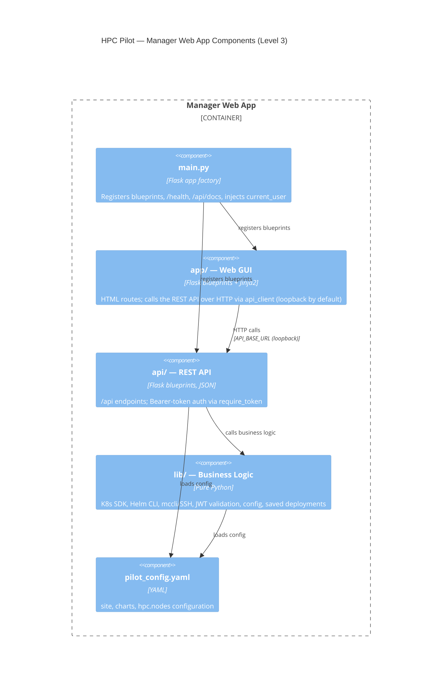
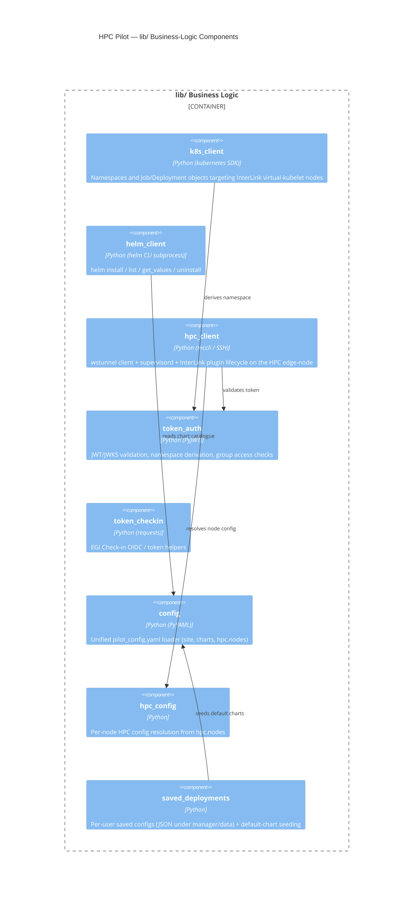

# Level 3 — Component

**Question:** what modules make up the Manager web app, and how do they fit
together?

The Manager is a single Flask process organised in three layers
(`app/` → `api/` → `lib/`), wired together by `main.py` and configured from
`pilot_config.yaml`.

## Manager Web App — top-level components

### Blueprints (routes) per layer

| Layer | Blueprints | Endpoints |
|---|---|---|
| `app/` (GUI) | `auth_bp`, `k8s_bp`, `helm_bp`, `hpc_bp`, `saved_bp` | `/login`, `/submit`, `/nodes`, `/deployments`, `/output`, … |
| `api/` (REST) | `k8s_bp`, `helm_bp`, `hpc_bp`, `saved_bp`, `docs_bp` | `/api/jobs`, `/api/interlink`, `/api/hpc/*`, `/api/docs` |
| `main.py` | — | `/health` (public liveness probe), Swagger UI |

## `lib/` — business-logic components

### Component → external system

| Component | Talks to | Via |
|---|---|---|
| `k8s_client` | Kubernetes API | `kubernetes` Python SDK (kubeconfig or in-cluster SA token) |
| `helm_client` | Kubernetes API | `helm` CLI subprocess |
| `hpc_client` | HPC edge-node | `mccli` CLI (SSH + OIDC token auth) |
| `token_auth` / `token_checkin` | EGI Check-in | HTTPS (JWKS + UserInfo endpoints) |
| `config` / `hpc_config` | local filesystem | `pilot_config.yaml` |
| `saved_deployments` | local filesystem / PVC | JSON files under `manager/data/` |
